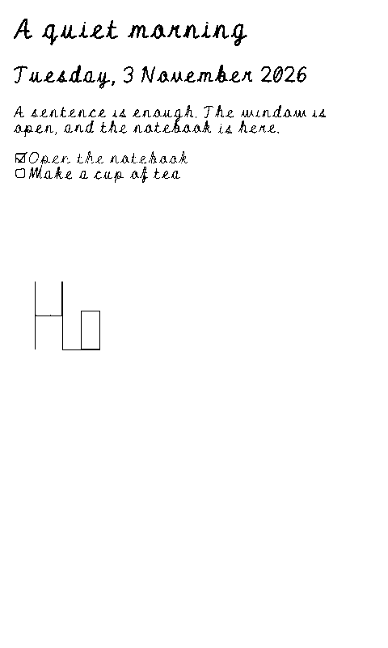

# Render a `.jotz` on e-paper with FreeInk

This reference explains how to display a Jot journal on a device such as the **original Xteink X4**. It covers both
page composition and the final pixels sent to the panel. Start with the local browser example to inspect the result
before attempting a device port.

For moving through the document, see [touch and button navigation](navigation.md). The same reader model can support
both, with input adapters for a button-only X4 or a correctly configured touch-capable device.
For complete document coverage, also use the [syntax inventory](syntax.md), [media and links](media-and-links.md),
[integration catalogue](integrations.md) and [all-record/profile ledger](profile-coverage.md). Reusing a preview's
appearance does not by itself implement every construct's inspection, interaction or offline behavior.

**Status, 3 November 2026:** the browser path is a working documentation example. The FreeInk C++ example below uses
source-verified APIs but has not been compiled for the X4 or tested on a physical panel. This is a rendering reference,
not a released Jot firmware or a change to the hardware roadmap.

FreeInk sources in this guide are pinned to
[`0dbf8cc5c32e3d3672365e497d6ee9163ac6b120`](https://github.com/Free-Ink/freeink-sdk/tree/0dbf8cc5c32e3d3672365e497d6ee9163ac6b120).
Check the APIs again when changing that revision.

## Choose where the page is composed

A `.jotz` contains source and attachments. It is not a screenshot, PDF, EPUB, or panel framebuffer. FreeInk supplies
display, input, graphics, font and layout facilities; a Jot adapter still has to turn the document into something
those facilities can render.

| Route | Where composition happens | What it preserves | Work still required |
| --- | --- | --- | --- |
| **Browser-rendered raster pages** | A computer using Jot's current JavaScript renderer | Closest match to existing handwriting, marks, images, charts and page styling | Device-sized pagination, monochrome conversion, page transfer and a small bitmap viewer |
| **Native Jot adapter** | Device firmware using FreeInk UI/font/book interfaces | Reflow and button navigation can be adapted to the device | Jot parsing or a derived intermediate format, supported-feature rules, asset handling, layout and memory management |
| **Jot → EPUB → reader** | A converter followed by an EPUB renderer | Reflow, font controls and navigation provided by the reader | A real EPUB exporter and validation of its CSS, images and semantic losses |

For a first visual proof, use the browser-rendered route. It reuses the renderer Jot already has. For a reader with
adjustable type and long documents, evaluate a native adapter or EPUB conversion separately. Jot's roadmap lists EPUB
export as planned work; changing the filename from `.jotz` to `.epub` does not perform that conversion.

## Know which X4 you are targeting

This guide's packing and firmware examples target the original ESP32-C3 X4. **X4 Pro** and **X4 Classic/V2** are
different targets. Do not combine their memory, power, touch, lighting or storage specifications.

| Property | Original X4 target |
| --- | --- |
| MCU/profile | ESP32-C3; FreeInk `FREEINK_DEVICE_X4=1` |
| Native framebuffer | 800 pixels across × 480 rows |
| Logical portrait page used here | 480 × 800 pixels |
| One monochrome frame | 48,000 bytes, or 46.875 KiB |
| Interaction | Seven physical buttons; no touchscreen or frontlight |
| RAM implication | No PSRAM; measure the application's available heap rather than treating panel size as its RAM budget |
| Panel/controller | Adafruit identifies GDEQ0426T82/SSD1677; the pinned SDK also contains X4 controller-variant detection |

Primary references: [Adafruit's X4 pinouts](https://learn.adafruit.com/circuitpython-on-the-xteink-x4-ereader/pinouts),
[Good Display's panel specification](https://www.good-display.com/product/957.html), and the pinned
[FreeInk board profile](https://github.com/Free-Ink/freeink-sdk/blob/0dbf8cc5c32e3d3672365e497d6ee9163ac6b120/libs/hardware/BoardConfig/include/BoardConfig.h#L1005-L1046).
The panel manufacturer lists up to four gray levels. This is not a promise about the appearance or speed of a
particular firmware's waveform.

## The complete visual pipeline

```text
chosen .jotz bytes
    ↓ verify package, extract source and assets
journal.txt + validated attachments
    ↓ parse Jot; resolve only explicitly supplied local assets/includes
Jot nodes and semantic values
    ↓ compose at the intended logical page size
480 × 800 portrait page(s)
    ↓ wait for fonts, images, charts and layout; detect overflow
opaque page pixels
    ↓ threshold or dither; rotate and pack for the selected driver
800 × 480 native 1-bit frame, 48,000 bytes
    ↓ SD-card read into the SDK framebuffer
FreeInk display refresh
    ↓
visible e-paper page
```

Keep source parsing, pagination, pixel encoding and panel refresh as separate stages. A PNG decoder does not understand
Jot records; a panel driver does not perform browser layout; a ZIP reader does not make a document an EPUB.

## Run the local reference example

From the repository root:

```sh
python3 -m http.server 8000 --bind 127.0.0.1 --directory .
```

Open <http://127.0.0.1:8000/docs/rendering/examples/x4-preview.html>.

The example starts with invented writing and an attachment from the repository's fictional packaged example. Open a
local `.jot` or `.jotz` to inspect a different page. It renders with Jot's own modules and locally bundled fonts and
capture library. File selection does not upload or persist journal writing.

The **Download 1-bit frame** action produces `page-0001.bin`: a headerless, native-orientation frame for the SDK path
below. It is not a new journal format and cannot be opened by assuming stock X4 firmware supports it.

The example renders one bounded page. **Overflow stops export.** Choose a smaller explicit excerpt or implement the
pagination contract below for a longer journal. It does not quietly crop a long page or claim to be a complete reader.

Sources: [browser example](examples/x4-preview.html) and [pixel encoder](examples/x4-pixels.mjs).

The tutorial's encoded sample, shown upright below, contains only black and white pixels. This is browser-produced
output before any panel waveform, not a device photograph. Its image source and invented writing are in the example.



## Open the package correctly

Use the existing container API on the host:

```js
import { readDocument } from './parser/container.mjs';
import { parse } from './parser/jot.mjs';

const doc = await readDocument(new Uint8Array(await file.arrayBuffer()));
const ast = parse(doc.source);
// doc.assets: [{ path, mediaType, byteLength, sha256, data: Uint8Array }, ...]
```

Import paths in snippets are relative to the consuming module. The runnable example uses the appropriate paths from
its own directory.

`readDocument()` detects plain source or a package by content. The container reader checks safe paths, the manifest,
declared sizes and asset hashes. Pass **source text** to `parse()`, not ZIP bytes. Use the supported raster snapshot of
an annotation for viewing; retain editable stroke JSON without treating it as display pixels or automatically
transcribing it.

The current host limits include 64 MiB input/expanded size, 32 MiB per asset, 1 MiB source/manifest, and 256 directory
entries. Those are host-reader limits, not appropriate allocation targets for the X4. The JavaScript reader eagerly
extracts the listed assets into memory. Do that work on the host for the raster route.

See the [container contract](../../specification/Jot-Container-v1.md) and [container implementation](../../parser/container.mjs).
An MCU package reader would need its own bounded streaming design, STORE/DEFLATE support, integrity checks and
explicit smaller limits. Silently skipping corrupt, missing or unsupported assets is not a compatible fallback.
A `.jotlock` needs an explicit unlock step through the [lock API](../../parser/LOCK.md) before package parsing;
the tutorial does not implement an unlock screen. A `.jotz` package itself is not encryption.

## Compose with Jot's browser renderer

The important API boundary is:

```js
import { renderPreview, addChartStyles } from './parser/preview.mjs';

addChartStyles(document);
renderPreview(ast, paper, {
  from: 'journal.txt',
  filename: file.name,
  asset: path => localAssetUrls.get(path) ?? null,
  include: path => localIncludeSources[path] ?? null,
  hand: { hand: 'script07', ink: 'black', pitchMm: 5, dots: false, seed: 1, pageRows: 0 }
});
```

`paper` must be connected to the document. Each asset result is `{ url, mediaType }`, normally using a Blob URL made
from verified package bytes. Keep those URLs alive until capture finishes, then revoke them. The explicit `filename`
supplies `{{document.filename}}`; it must be the opened file's basename, not an invented journal fact.

The `include()` callback is synchronous. If the package has `.jot` include members, gather and decode them first with
[`include.mjs`](../../parser/include.mjs), using a reader limited to verified package members. Unavailable includes
should show their existing notice. Do not implicitly read a host directory or fetch a URL. Image paths passed to
`asset()` remain the written paths even inside an include; the current renderer does not automatically rebase an
included image path to that file's folder. Use unambiguous package-root asset paths when preparing the document.

The handwriting option is optional. A native reader may begin with typed text and then add registered handwriting
fonts after checking their small-screen legibility. The existing renderer supplies styles and chart rendering; it
does not supply an X4 paginator or pixel encoder.

### Set the size before measuring

Compose at 480 × 800 logical pixels, with a device pixel ratio of 1 for capture. Do not render an A4 page and shrink it
to fit. CSS millimeters in Jot's grid geometry use the browser's 96 px/in conversion; they are not calibrated physical
millimeters on a roughly 219-PPI panel.

Use a white page, light theme and a single reading column. Start with a few body sizes, for example 24, 28 and 32 px,
and margins between 16 and 24 px as **test settings**, not evidence-established accessibility minima. Inspect the
result at native size and on the panel. Leave room for any device header/footer in the layout budget.

For images, choose a maximum displayed rectangle and preserve aspect ratio. A tall scan can be fitted intact, placed
on its own page, or given a separately designed zoom view. Thin handwriting in a scaled scan may become illegible;
fitting the whole image is not proof that its writing is readable.

### Wait for all visual inputs

`renderPreview()` returns the element. Its `jotReady` property is a Promise; it is not an all-assets-ready guarantee.
Before measuring or capturing:

1. Make images eager, await their `decode()` results, and show failures explicitly.
2. Load the chosen registered font faces, await `document.fonts.ready`, and check that the required faces loaded.
   The renderer catches some font-load failures internally; successful `jotReady` alone does not prove font fidelity.
3. Await `paper.jotReady`. For handwritten pages, rerun `alignToGrid(paper, hand)` after images and fonts settle.
4. Resize/repaint chart instances after the final dimensions settle. The existing chart model disables animation.
5. Finish or disable checkbox/other animations and wait for layout to settle before capture.
6. Check both height and width. Missing images, fallback fonts and overflow must not be mistaken for a finished frame.

Also choose the intended detail state before capture. The current chart numbers table begins inside closed `details`,
and some compact record previews omit fields. Produce separate data/field pages or explicitly expand and paginate the
chosen details. The single-page tutorial does not implement those views. It also does not select animation frames;
use a deliberately prepared static rendition when deterministic animated-image output is needed.

The example uses the existing locally bundled `toCanvas()` with `pixelRatio: 1`, a white background and a 480 × 800
output. It lets the capture library embed fonts. This is DOM-to-pixel capture on the host, not an ESP32 browser.

### Pagination is a separate layer

Neither CSS `@page` nor a fixed screenshot height automatically paginates the browser preview. Jot's `===` page-break
syntax is an input a paginator should honor; screenshot capture does not turn it into a new image by itself.

A production raster exporter should:

- Reserve header, footer and margin space, then measure the final loaded layout inside the remaining content area.
- Break at explicit page breaks and safe block boundaries. Split long prose at rendered line boundaries if needed.
- Keep a heading with following content and image captions with their images where feasible.
- Split long lists/tables with repeated context, or use an explicit alternative presentation. A wide table cannot be
  made readable merely by hiding its overflow.
- Give oversized scans, charts and code blocks a documented fit, separate-page or zoom behavior.
- Check every output page for overflow. Do not slice a tall bitmap every 800 pixels through text or a record.
- Preserve the original document separately and label a selected excerpt as an excerpt.

The tutorial's single-page guard is intentionally smaller than this contract. It establishes a complete one-page
path without presenting unimplemented pagination as an available feature.

## Convert the page into the X4's pixels

For the pinned original-X4 API, the native monochrome buffer has this contract:

| Field | Value |
| --- | --- |
| Geometry | 800 × 480 |
| Row stride | 100 bytes |
| Pixel traversal | Row-major, most significant bit first within each byte |
| White | Bit 1 |
| Black | Bit 0 |
| Total bytes | `800 / 8 * 480 = 48000` |

The browser's RGBA image takes `480 * 800 * 4 = 1536000` bytes before other overhead. This is one reason to perform
composition on a computer rather than allocating a browser-sized pixel image on the original X4.

### Rotate exactly once

FreeInk's portrait mapping for this geometry is:

```js
const nativeX = logicalY;
const nativeY = 479 - logicalX;
const byteIndex = nativeY * 100 + (nativeX >> 3);
const mask = 0x80 >> (nativeX & 7);
// Start with an all-white Uint8Array(48000).fill(0xff).
// Clear mask at byteIndex for a black pixel; leave it set for white.
```

| Logical portrait corner | Native coordinate |
| --- | --- |
| Top left `(0, 0)` | `(0, 479)` |
| Top right `(479, 0)` | `(0, 0)` |
| Bottom left `(0, 799)` | `(799, 479)` |
| Bottom right `(479, 799)` | `(799, 0)` |

The example encoder applies this rotation. Send its bytes directly to the native SDK framebuffer; do not also rotate
them through a UI target. The display facade has no general `setRotation()` method. FreeInk UI and Book frame targets
provide their own coordinate transforms for native drawing.

The [encoder](examples/x4-pixels.mjs) composites transparent pixels onto white, computes a simple luma threshold and
packs the bits. Its threshold is an adjustable prototype choice, not a measured optimum. The resulting file has no
PNG, BMP or PBM header. An all-white page is 48,000 `0xff` bytes; an all-black page is 48,000 zero bytes.

### Keep meaning after losing color

Use solid dark text and visible task/status marks. Do not rely on a colored highlight, mood cell or chart line alone:
include labels, shapes, patterns or the renderer's numeric table. Antialiased thin strokes and pale dots can disappear
after thresholding. Compare typed and handwritten text, especially punctuation and small numerals.

For photos or scans, evaluate dithering separately from the text path. A textured whole-page dither can make text and
white areas noisy. Inspect the final encoded image, not only the attractive color browser preview.

### Optional four-level grayscale

The pinned SDK documents four-tone support for X4 controller paths. Check
`display.grayscaleCapabilities(freeink::GrayscaleMode::Absolute)` and follow the matching
[grayscale capability contract](https://github.com/Free-Ink/freeink-sdk/blob/0dbf8cc5c32e3d3672365e497d6ee9163ac6b120/docs/grayscale-capabilities.md).

Absolute-tone input uses two bit planes with different semantics from overlay masks. The monochrome file in this
tutorial is neither of those grayscale inputs. Grayscale needs a separate encoder, plane memory budget and refresh
path. Do not assume that `drawImage()` will infer it from PNG data or that a fast monochrome refresh preserves gray
tones. Measure actual tone separation and ghosting on the selected panel before choosing it for text or scans.

## Feed a native frame to FreeInk

The following is a **source-checked, uncompiled integration example**. It reads one complete prepared frame from an
SD card into SDK-owned memory, then performs a blocking full refresh. It does not parse `.jotz` on the device.

```cpp
#include <Arduino.h>
#include <BoardConfig.h>
#include <EInkDisplay.h>
#include <SDCardManager.h>
#include <XteinkDetect.h>

EInkDisplay display(0, 0, 0, 0, 0, 0);
// At this SDK revision, begin() takes wiring from BoardConfig.
// The constructor arguments are retained for legacy API compatibility.

bool showNativePage(const char* path) {
  if (!SdMan.ready() || !display.framebufferReady() ||
      display.getDisplayWidth() != 800 || display.getDisplayHeight() != 480 ||
      display.getBufferSize() != 48000) {
    return false;
  }
  FsFile file = SdMan.open(path, O_RDONLY);
  if (!file) return false;
  if (file.isDirectory() || file.fileSize() != display.getBufferSize()) {
    file.close(); return false;
  }

  uint8_t* frame = display.getFrameBuffer();
  size_t offset = 0;
  while (offset < display.getBufferSize()) {
    const size_t remaining = display.getBufferSize() - offset;
    const size_t count = remaining < 1024 ? remaining : 1024;
    const int read = file.read(frame + offset, count);
    if (read <= 0) { file.close(); return false; }
    offset += static_cast<size_t>(read);
  }
  file.close();
  display.displayBuffer(EInkDisplay::FULL_REFRESH);
  return true;
}

void setup() {
  Serial.begin(115200);
  BoardConfig::holdPowerRails();
  BoardConfig::releaseSdRail();
  freeink::applyXteinkDisplayController(); // Before display.begin().
  if (!SdMan.begin()) { Serial.println("SD unavailable"); return; }
  display.begin();                     // Returns void.
  if (!showNativePage("/jot/page-0001.bin")) {
    Serial.println("Page unavailable");
  }
}

void loop() {
  delay(20); // Add explicit button-driven page selection in the application.
}
```

Copy the tutorial's downloaded file to `/jot/page-0001.bin` on the SD card for an application using this loader.
SDK availability alone does not install a viewer in stock firmware.

The SDK owns `getFrameBuffer()`'s memory; do not free it. Reacquire the pointer for every subsequent page: double-buffer
builds may swap writable buffers after a blocking refresh. `setFramebuffer(bytes)` is another option when a complete
native frame already exists in RAM, but it copies the buffer rather than adopting the pointer. Reading into the SDK's
current buffer avoids a second 48,000-byte page allocation.

This sample requires the active X4 profile. A combined X3/X4 firmware must select the correct board before storage and
display initialization. Use the SDK's detection helpers rather than mixing a Pro or X3 pinout with these dimensions.
The original X4 storage path is SPI/SdFat; Pro/other-board SDMMC settings are not interchangeable.

### Use a pinned SDK project

In a separate firmware project, check out the pinned SDK as `freeink-sdk/`, put the C++ example in `src/main.cpp`, and
use a configuration based on the pinned
[`platformio.sample.ini`](https://github.com/Free-Ink/freeink-sdk/blob/0dbf8cc5c32e3d3672365e497d6ee9163ac6b120/platformio.sample.ini).

```sh
git clone https://github.com/Free-Ink/freeink-sdk.git freeink-sdk
git -C freeink-sdk checkout --detach 0dbf8cc5c32e3d3672365e497d6ee9163ac6b120
```

A minimal starting configuration for this example is:

```ini
[env:xteink_x4]
platform = https://github.com/pioarduino/platform-espressif32/releases/download/55.03.37/platform-espressif32.zip
framework = arduino
board = esp32-c3-devkitm-1
board_build.flash_mode = dio
board_build.flash_size = 16MB
monitor_speed = 115200
build_unflags = -std=gnu++11
build_flags =
  -std=gnu++2a
  -DARDUINO_USB_MODE=1
  -DARDUINO_USB_CDC_ON_BOOT=1
  -DEINK_DISPLAY_SINGLE_BUFFER_MODE=1
  -DFREEINK_DEVICE_X4=1
lib_deps =
  BoardConfig=symlink://freeink-sdk/libs/hardware/BoardConfig
  EInkDisplay=symlink://freeink-sdk/libs/display/FreeInkDisplay
  SDCardManager=symlink://freeink-sdk/libs/hardware/SDCardManager
  XteinkDetect=symlink://freeink-sdk/libs/hardware/XteinkDetect
```

After installing PlatformIO in that separate project, the build command is `pio run -e xteink_x4`. Pin and record
resolved transitive dependencies as well as the SDK revision. A successful build would establish compilation, not
panel behavior or Jot reader compatibility. This documentation does not provide a flashed firmware artifact.

The pinned source is the authority for two details that older prose can obscure: X4 builds include controller variants,
and `applyXteinkDisplayController()` uses the live panel probe; the saved OEM screen type is diagnostic. Avoid copying
an old "SSD1677 only" or "NVS-first" assumption into a new adapter.

## Native layout and EPUB alternatives

FreeInk is more than a low-level pixel driver:

- **FreeInk UI** supplies drawing, text, layout primitives and a framebuffer display target.
- **FreeInk Font** supplies native font handling. Browser WOFF2 loading and native font support are different paths;
  retain appropriate font licenses and measure rasterization and cache costs.
- **FreeInkBook** supplies EPUB parsing, a streaming CSS subset, pagination, images, fonts and page rendering. It also
  exposes `ChapterLayout::layoutPlainText()` and `PageRenderer::renderText()` without requiring a whole EPUB.

Plain-text layout does not interpret Jot headings, tasks, records, colors, charts or embedded assets. Its single
newlines become spaces and blank lines create paragraphs. Passing `journal.txt` directly therefore gives a text
fallback, not a faithful Jot visual renderer.

A native adapter should specify support for each construct before claiming compatibility:

| Jot content | Adapter responsibility |
| --- | --- |
| Paragraphs, headings, lists, task states | Preserve semantics; shape text, wrap lines and page it |
| Records and date context | Select a documented visual presentation; do not silently invent values |
| Images and annotated snapshots | Resolve verified assets, decode supported rasters, fit or paginate them |
| Stroke JSON | Preserve the attachment; view a composed snapshot unless a stroke renderer is implemented |
| Tables and code | Reflow, split, offer a different layout, or show a clear limitation |
| Charts and queries | Reproduce the supported calculations and labels, use a host-rendered view, or show an explicit fallback |
| Colors and highlights | Map meaning to labels/patterns as well as grayscale |
| Filename variables and includes | Supply explicit host context and equivalent local resolution rules |
| Unknown constructs or diagram fences | Preserve source and identify unsupported rendering; do not execute them |

FreeInkBook's documentation includes examples with two 512-KiB arenas. Those allocations are not an original-X4 RAM
recommendation. Evaluate the smaller configuration, peak allocations, fonts, images and page caches against measured
available heap. A small fixture's memory result is not an upper bound for every journal.

For EPUB, generate a valid EPUB package with its required metadata, navigation and content documents. FreeInkBook
expects `META-INF/container.xml` and an OPF package, not Jot's `manifest.json` plus `journal.txt`. Browser CSS and Jot's
handwriting appearance will need a deliberate conversion policy. Keep the `.jotz` source independently; a derived
EPUB need not be a lossless or editable replacement.

## Refresh, navigation and caches

See [navigation](navigation.md) for paging, input, hit maps and resume state. Cache identity includes source/assets, renderer, geometry, fonts and pixel encoding. Refresh only after a complete page is ready; measure full/half/fast behavior on the selected panel. A bitmap cache can reveal writing even when its source was locked; choose the sleep image deliberately.

## Diagnose the image before tuning the panel

| Symptom | Check first |
| --- | --- |
| Black background, white writing | Bit polarity; initialize white with `0xff` |
| Rotated or mirrored page | Portrait transform and whether rotation was applied twice |
| Repeated strips or diagonal corruption | Native width, row stride, MSB-first bit order, file size and unexpected image headers |
| Missing or substituted type | Font loading before layout and font embedding during DOM capture |
| Open/done boxes look like solid squares | SVG paint inheritance during DOM-to-image capture; the tutorial makes the canonical paths' computed paint explicit before capture |
| Missing images or unexpected whitespace | Asset resolver, image decoding, include paths and unsupported formats |
| Cut-off final lines or tables | Pagination/overflow contract, not the refresh waveform |
| Correct PNG but weak text on the panel | Quantization, stroke size, tone mapping, actual lighting and panel behavior |
| Old page faintly visible | Ghosting and refresh policy, after confirming the new buffer is correct |
| Second page corrupt | Reacquire the SDK framebuffer after a buffer swap; verify the next file read completed |

## Validation and remaining device work

Run the [shared acceptance checks](README.md#acceptance-checks), then test packing corners, actual panel/controller, input, memory, ghosting, refresh recovery and readability. Browser output does not establish physical-device behavior.

## Sources and check scope

Checked 3 November 2026. Local Jot APIs were inspected and the browser composition/capture route exercised in Chromium.
SDK APIs and geometry were inspected in the pinned source checkout. No firmware compilation, flashing, panel refresh,
battery measurement or physical readability test was performed. FreeInk's rendered documentation website was not
reliably readable through the research tools; the repository's documentation and source were used instead.

### Jot contracts and research

- [Container contract](../../specification/Jot-Container-v1.md), [container reader](../../parser/container.mjs),
  [parser API](../../parser/README.md), [preview renderer](../../parser/preview.mjs),
  [handwriting geometry](../../parser/handwriting.mjs), [local includes](../../parser/include.mjs), and
  [HTML export](../../parser/export.mjs). HTML export can embed linked attachment bytes as well as images; it is not
  a safe substitute for selecting what to share.
- [Bundled browser capture library](../../site/dist/vendor/browser/README.md), used by the reference example.
- [E-ink methods research](../methods/e-ink-templates.md), especially sections 9, 18, 19 and 25. Its Journalwright/X4
  implementation tables describe an upstream project. Its historic timings, fixed refresh cadence and unresolved
  grayscale question are not current FreeInk guarantees. This reference allows optional four-tone rendering based on
  the newer SDK contract; it does not claim that grayscale photos improve reading or avoid ghosting.

### FreeInk at the pinned revision

- [Display API and runtime buffer access](https://github.com/Free-Ink/freeink-sdk/blob/0dbf8cc5c32e3d3672365e497d6ee9163ac6b120/libs/display/FreeInkDisplay/include/FreeInkDisplay.h).
- [Packing, buffer copy, blocking refresh and buffer swaps](https://github.com/Free-Ink/freeink-sdk/blob/0dbf8cc5c32e3d3672365e497d6ee9163ac6b120/libs/display/FreeInkDisplay/src/FreeInkDisplay.cpp).
- [Portrait coordinate transform](https://github.com/Free-Ink/freeink-sdk/blob/0dbf8cc5c32e3d3672365e497d6ee9163ac6b120/libs/ui/FreeInkUI/include/FreeInkUIDisplayTarget.h#L326-L358).
- [SD-card API](https://github.com/Free-Ink/freeink-sdk/blob/0dbf8cc5c32e3d3672365e497d6ee9163ac6b120/libs/hardware/SDCardManager/include/SDCardManager.h) and
  [panel detection](https://github.com/Free-Ink/freeink-sdk/blob/0dbf8cc5c32e3d3672365e497d6ee9163ac6b120/libs/hardware/XteinkDetect/include/XteinkDetect.h).
- [FreeInk UI](https://github.com/Free-Ink/freeink-sdk/blob/0dbf8cc5c32e3d3672365e497d6ee9163ac6b120/docs/freeink-ui.md),
  [FreeInkBook](https://github.com/Free-Ink/freeink-sdk/blob/0dbf8cc5c32e3d3672365e497d6ee9163ac6b120/docs/freeink-book.md),
  [plain-text layout](https://github.com/Free-Ink/freeink-sdk/blob/0dbf8cc5c32e3d3672365e497d6ee9163ac6b120/libs/book/FreeInkBook/include/layout/ChapterLayout.h#L136-L144), and
  [native text/page rendering](https://github.com/Free-Ink/freeink-sdk/blob/0dbf8cc5c32e3d3672365e497d6ee9163ac6b120/libs/book/FreeInkBook/include/render/PageRenderer.h#L53-L70).
- [MIT license and attribution](https://github.com/Free-Ink/freeink-sdk/blob/0dbf8cc5c32e3d3672365e497d6ee9163ac6b120/NOTICE).
